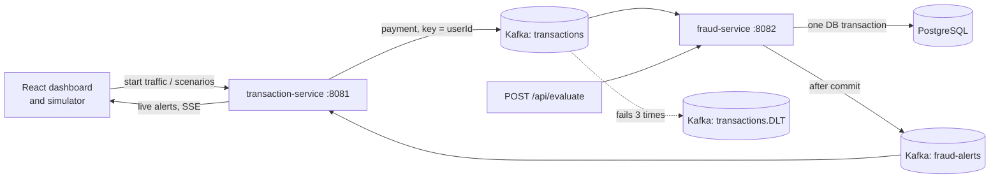

# Real-Time Fraud Detection System

An event-driven payment fraud detection system. Payments flow through Kafka, a rule engine scores each one, and every payment gets an **ALLOW / REVIEW / BLOCK** decision that is stored with the reasons behind it. A React dashboard shows alerts live.

> **Note:** all payments are simulated by a built-in traffic generator. No real data is used.

**Tech stack:** Java, Spring Boot, Apache Kafka, PostgreSQL, React, Docker


## Architecture



- **transaction-service (8081):** generates simulated payments and fraud scenarios, publishes them to Kafka, serves alerts and stats to the dashboard, and streams new alerts live (SSE).
- **fraud-service (8082):** consumes payments, runs the rules, stores decisions, and exposes the decision API.
- **Kafka** decouples the two services. Payments are keyed by `userId`, so one user's payments are always processed in order.

## How a decision is made

Each rule that fires adds points. The total is capped at 100.

| Rule | Fires when | Points |
|---|---|---|
| VELOCITY | more than 5 payments by one user within 60 seconds | 40 |
| IMPOSSIBLE_TRAVEL | two payments from cities too far apart to travel between at 900 km/h | 50 |
| NEW_DEVICE | the device has never been used by this user | 30 |
| UNUSUAL_AMOUNT | amount is more than 10 times the user's average | 40 |
| DAILY_LIMIT | more than Rs 1,00,000 spent within 24 hours | 35 |

**Total below 30 = ALLOW, 30 to 69 = REVIEW, 70 or more = BLOCK.**

## Design decisions

- **One database transaction per payment.** Saving the payment, running the rules, saving the decision and saving the alert happen together, so a crash can never leave a payment stored without its alert. The alert is sent to Kafka only after the commit.
- **Idempotent processing.** Kafka can deliver a message twice. Sending the same `transactionId` again returns the first decision instead of creating a second one.
- **Dead-letter topic.** A message that fails 3 times is moved to `transactions.DLT` instead of blocking its partition.
- **Per-user ordering.** Partitioning by `userId` keeps one user's payments in order, which the velocity and travel rules depend on.
- **Every decision is stored**, ALLOW included, together with the rules that fired (`decisions` and `decision_rules` tables).
- **Rules, not ML.** Rules are explainable, because every decision lists its reasons. The data here is simulated, so a model trained on it would only learn the generator's patterns.

## API

| Endpoint | Description |
|---|---|
| `POST /api/evaluate` (fraud-service) | Send one payment, get the decision back immediately |
| `GET /api/decisions/{transactionId}` | Score and the rules that fired for one payment |
| `GET /api/stats` (transaction-service) | Counts for the dashboard |

Example:

```bash
curl -X POST http://localhost:8082/api/evaluate \
  -H "Content-Type: application/json" \
  -d '{"userId":"U1","amount":50000,"city":"Delhi","deviceId":"new-phone"}'
```

Returns `{ "decision": "...", "riskScore": ..., "rules": [...] }`. An unknown user returns 422.

## Run it locally

Requirements: Java 21, Node.js, Docker.

```bash
# 1. Start PostgreSQL and Kafka
docker compose up -d

# 2. Start the two services (separate terminals)
cd backend/fraud-service && ./mvnw spring-boot:run
cd backend/transaction-service && ./mvnw spring-boot:run

# 3. Start the dashboard
cd frontend && npm install && npm run dev
```

Open the URL that `npm run dev` prints (usually http://localhost:5173), go to **Simulator**, press **Start traffic**, then run a fraud scenario such as **Account takeover** and watch the **Dashboard**.

Database, Kafka and password settings can be overridden with the environment variables `DB_URL`, `DB_USER`, `DB_PASSWORD` and `KAFKA_BOOTSTRAP`.

## Tests

```bash
cd backend/fraud-service && ./mvnw test
```

## Limitations and next steps

- Data is simulated.
- Not load-tested yet.
- Planned: analyst feedback (mark an alert as fraud or legitimate) with precision per rule, a load test, and editable rules with an audit log.
