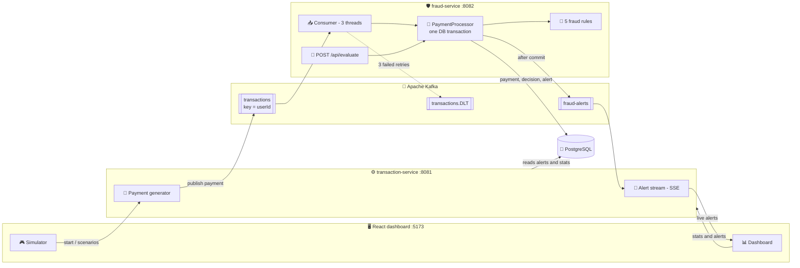
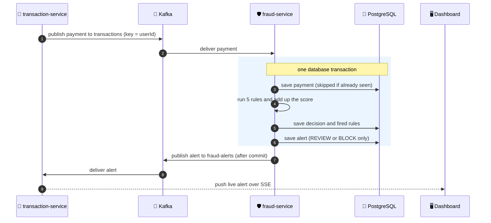

# 🛡️ Real-Time Fraud Detection System

**An event-driven payment fraud pipeline: payments flow through Kafka, five explainable rules score each one, and every payment gets an ALLOW / REVIEW / BLOCK decision that is stored together with the reasons behind it. A React dashboard shows alerts live.**


> ⚠️ **All payments are simulated** by a built-in traffic generator. No real customer or card data is used, and the rules are deliberately simple so every decision can be explained. See [Limitations](#-limitations-and-roadmap).


## 📑 Contents

[Features](#-features) · [Architecture](#-architecture) · [How a decision is made](#-how-a-decision-is-made) · [Design decisions](#-design-decisions) · [A bug I found and fixed](#-a-bug-i-found-and-fixed) · [API](#-api) · [Run it locally](#-run-it-locally) · [Tests](#-tests) · [Project structure](#-project-structure) · [Limitations and roadmap](#-limitations-and-roadmap)

## ✨ Features

- 📨 **Two Spring Boot microservices connected by Kafka**, each acting as both producer and consumer.
- 📏 **Five fraud rules** (velocity, impossible travel, new device, unusual amount, daily limit) that add up to a risk score.
- ✅ **ALLOW / REVIEW / BLOCK decisions**, all stored with the rules that fired, so every decision can be explained.
- 🔒 **One database transaction per payment**, so a crash cannot leave a payment saved without its alert.
- ♻️ **Idempotent processing**: a message delivered twice produces one decision, not two.
- 💀 **Dead-letter topic**: a message that keeps failing is retried 3 times and then parked in `transactions.DLT`.
- 🔌 **Synchronous decision API** (`POST /api/evaluate`) next to the asynchronous pipeline.
- 📊 **Live React dashboard** with alerts streamed over Server-Sent Events (SSE), stats, and a simulator to trigger fraud scenarios.

## 🏗️ Architecture



### 🔄 Life of one payment



### 📨 Kafka topics and who uses them

| Service | Produces to | Consumes from |
|---|---|---|
| **transaction-service** (8081) | `transactions` (keyed by `userId`, 3 partitions) | `fraud-alerts`, then streams alerts to the dashboard over SSE |
| **fraud-service** (8082) | `fraud-alerts`, after the database commit | `transactions` (consumer group with 3 threads); messages that keep failing go to `transactions.DLT` |

## 📏 How a decision is made

Each rule that fires adds points. The total is capped at 100.

| Rule | Fires when | Points |
|---|---|---|
| ⏱️ `VELOCITY` | more than 5 payments by one user within 60 seconds | 40 |
| ✈️ `IMPOSSIBLE_TRAVEL` | two payments from cities too far apart to reach at 900 km/h | 50 |
| 📱 `NEW_DEVICE` | the device has never been used by this user | 30 |
| 💰 `UNUSUAL_AMOUNT` | amount is more than 10 times the user's average amount | 40 |
| 🧾 `DAILY_LIMIT` | more than Rs 1,00,000 spent within 24 hours | 35 |

| Total score | Decision |
|---|---|
| below 30 | ✅ **ALLOW** |
| 30 to 69 | 👀 **REVIEW** |
| 70 or more | ⛔ **BLOCK** |

The **Simulator** page can trigger each rule on demand:

| Scenario | What it sends |
|---|---|
| Velocity burst | 8 payments in 8 seconds |
| Impossible travel | home city, then a far city 10 minutes later |
| New device | a payment from a device the user never used |
| Big amount | 15 times the normal payment |
| Daily limit | three Rs 40,000 payments within 2 hours |
| Account takeover | new device + far city + big amount, which ends in a **BLOCK** |

## 🧠 Design decisions

| Decision | Why |
|---|---|
| **One DB transaction per payment** (save payment, run rules, save decision, save alert) | Either everything is stored or nothing is. The Kafka alert is sent only after the commit, so the dashboard never shows something the database does not have. |
| **Idempotent processing**: a repeated `transactionId` returns the first decision | Kafka can deliver a message more than once. Without this, one payment could be scored and alerted twice. |
| **Partition key = `userId`** | Velocity and impossible-travel rules depend on the order of one user's payments. Kafka only guarantees order inside a partition, so one user always goes to the same partition. |
| **Dead-letter topic** with 3 retries | One bad message cannot block a partition forever, and nothing is silently lost. |
| **Every decision is stored**, ALLOW included, with the rules that fired | Decisions can be explained and counted later, not only the alerts. |
| **Rules, not ML** | Rules are explainable: every decision lists its reasons. The data is simulated, so a model trained on it would only learn the generator's patterns. |
| **Synchronous `/api/evaluate` beside the async pipeline** | Shows both ways a payment system can ask "is this payment safe?": wait for the answer, or react to an event. |
| **Config from environment variables**, with local defaults | Passwords and addresses are not hard-wired for other machines, and the project still starts with no setup. |

## 🐞 A bug I found and fixed

The first version saved the payment, then ran the rules, then saved the alert, as three separate steps. If the service crashed between the first and the last step, Kafka delivered the message again, the payment was found to be a duplicate and was skipped, and **the alert was never created**.

**Fix:** save the payment, the decision and the alert in a single database transaction, and publish to Kafka only after the commit. Now a crash rolls everything back and the redelivered message is processed from scratch. A second, smaller fix: one rule reported a score of 40 on the Rules page while the engine used 50, so every rule now reads its score from a single `score()` method.

## 🔌 API

**fraud-service** (`:8082`)

| Endpoint | Description |
|---|---|
| `POST /api/evaluate` | Send one payment and get the decision back immediately |
| `GET /api/decisions/{transactionId}` | Score and fired rules for one payment |
| `GET /api/rules` | The rules, with their descriptions and points |

**transaction-service** (`:8081`)

| Endpoint | Description |
|---|---|
| `GET /api/alerts?limit=50` | Latest alerts |
| `GET /api/alerts/stream` | Live alerts over SSE |
| `GET /api/stats` | Counts of transactions, allowed, in review and blocked |
| `GET /api/transactions` | Latest payments |
| `POST /api/simulator/start` · `stop` · `GET status` | Control the traffic generator |
| `POST /api/simulator/scenario/{type}` | Trigger a fraud scenario |

### Example

```bash
curl -X POST http://localhost:8082/api/evaluate \
  -H "Content-Type: application/json" \
  -d '{"userId":"U1","amount":50000,"city":"Delhi","deviceId":"my-new-phone"}'
```

Returns the decision, the score, and every rule that fired, for example:

```json
{
  "transactionId": "generated-uuid",
  "userId": "U1",
  "riskScore": 70,
  "decision": "BLOCK",
  "rules": [
    { "name": "UNUSUAL_AMOUNT", "score": 40, "reason": "Amount 50000.0 is more than 10x user's average 500.0" },
    { "name": "NEW_DEVICE", "score": 30, "reason": "Device my-new-phone has never been used by this user" }
  ],
  "decidedAt": "2026-01-01T10:00:00Z"
}
```

(The values above are illustrative; the exact rules depend on the user and their history.) A missing field returns **400**, and an unknown user returns **422**.

## 🚀 Run it locally

**Requirements:** Java 21, Node.js (LTS), Docker Desktop.

```bash
# 1. Clone
git clone https://github.com/Shreshtha9/<repo-name>.git
cd <repo-name>

# 2. Start PostgreSQL and Kafka
docker compose up -d
```

**3. Create the database tables.** The schema and 500 simulated users are in `db/init.sql`. If your compose file does not load it automatically, run it once:

```bash
# Linux / macOS / Git Bash
docker compose exec -T postgres psql -U fraud -d frauddb < db/init.sql

# Windows PowerShell
Get-Content db/init.sql | docker compose exec -T postgres psql -U fraud -d frauddb
```

**4. Start the two services** (in separate terminals):

```bash
cd backend/fraud-service && ./mvnw spring-boot:run          # Windows: mvnw.cmd spring-boot:run
cd backend/transaction-service && ./mvnw spring-boot:run
```

**5. Start the dashboard:**

```bash
cd frontend
npm install
npm run dev
```

Open the URL it prints (usually **http://localhost:5173**), go to **Simulator**, press **Start**, then run **Account takeover** and watch the **Dashboard**.

### ⚙️ Configuration

Everything has a default that matches the local Docker setup. To override, set an environment variable or put it in a `.env` file in the project root:

| Variable | Default |
|---|---|
| `DB_URL` | `jdbc:postgresql://localhost:5432/frauddb` |
| `DB_USER` | `fraud` |
| `DB_PASSWORD` | `fraud123` (a local demo password; change it for anything else) |
| `KAFKA_BOOTSTRAP` | `localhost:9092` |

## 🧪 Tests

```bash
cd backend/fraud-service
./mvnw test
```

`FraudEngineTest` covers the scoring engine: no rule fires, the REVIEW threshold (29 vs 30), the BLOCK threshold, and the cap at 100. `FraudServiceApplicationTests` loads the full application, so it needs PostgreSQL and Kafka running.

## 🗂️ Project structure

```
.
├── backend
│   ├── fraud-service          # consumes payments, scores them, stores decisions
│   │   └── src/main/java/com/frauddetector/fraud
│   │       ├── consumer       # Kafka listener
│   │       ├── processor      # PaymentProcessor: the transactional core
│   │       ├── engine         # FraudEngine: adds up rule scores
│   │       ├── rules          # the five rules
│   │       ├── repository     # JDBC access
│   │       ├── controller     # /api/evaluate, /api/decisions, /api/rules
│   │       └── config         # Kafka topics, retries, dead-letter, CORS
│   └── transaction-service    # generates payments, serves the dashboard
├── frontend                   # React + Vite dashboard
├── db                         # schema and seed data
├── docs                       # screenshots
└── docker-compose.yml         # PostgreSQL and Kafka
```

## 🚧 Limitations and roadmap

**Known limitations**

- 🧪 All data is simulated, and the rule thresholds are fixed in code.
- 📈 A single Kafka broker and no load testing, so there are **no claims about scale or latency**.
- 🔓 The APIs have no authentication.
- ⚡ Two simultaneous `/api/evaluate` calls for the same user are not serialised, so a rule such as velocity could briefly undercount. Payments through Kafka are not affected, because each user's payments stay in one partition.

**Ideas for next steps**

- 🏷️ Label the simulated payments as normal or fraud, and measure precision and recall per rule.
- 🔁 Make thresholds configurable and replay stored payments to see the effect of a change before applying it.
- 🔐 Add a per-user lock on the synchronous path, plus integration tests with Testcontainers.

## 👩‍💻 Author

**Shreshtha** · [GitHub](https://github.com/Shreshtha9)
